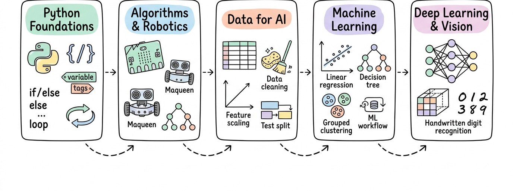

# Introduction to AI with Python

[](LICENSE)
[](https://github.com/wlos/ai_with_python_course/graphs/contributors)
[](https://github.com/wlos/ai_with_python_course/issues)
[](https://github.com/wlos/ai_with_python_course/pulls)
[](https://github.com/wlos/ai_with_python_course/pulls)

[](https://github.com/wlos/ai_with_python_course/watchers)
[](https://github.com/wlos/ai_with_python_course/network/members)
[](https://github.com/wlos/ai_with_python_course/stargazers)
[](https://mybinder.org/v2/gh/wlos/ai_with_python_course/main)
[](https://github.com/wlos/ai_with_python_course/discussions)


Welcome to the **Introduction to AI with Python** curriculum. This course introduces learners to the complete journey from computational thinking and Python programming fundamentals to physical computing with the BBC micro:bit & Maqueen robot, tabular data analysis with Pandas, and classical machine learning and deep learning computer vision.

- 🌐 **Course Website**: <https://wlos.github.io/ai_with_python_course/>
- 🗺️ **Interactive Roadmap**: [Mindmap of the Course](mindmap.html) · [Online Mindmap](https://wlos.github.io/ai_with_python_course/mindmap.html)

## 🛠️ What You'll Build

### 🎯 Core Competencies

- **Python Foundations & Collections**: Master core syntax, conditional logic, loops, custom function authoring, and data collections (lists, tuples, sets, dictionaries).
- **Physical Computing & Robotics**: Write MicroPython scripts to control hardware sensors, indicator and RGB LEDs, and dual DC motors on the Maqueen robotic car.
- **Data Wrangling with Pandas**: Load tabular CSV, Excel, and SQL database records, cleanse missing values, and combine multi-table datasets with merges and joins.
- **Applied Machine Learning**: Build, evaluate, and tune regression models, decision trees, random forests, and K-means clustering pipelines with scikit-learn.
- **Deep Learning Foundations**: Construct and compare multilayer perceptrons and convolutional neural networks for handwritten digit image classification.

### 🏗️ Practical Projects

- **Maqueen Autonomous Obstacle Navigator**: Program a two-wheeled robot to detect obstacles using ultrasonic waves and execute evasive turns autonomously.
- **California Housing Valuation Predictor**: End-to-end regression model with feature scaling, cross-validation, and error metrics.
- **Customer Segmentation & Recommender Engine**: Segment retail customers into behavioural clusters with K-means to suggest tailored product promotions.
- **MNIST Handwritten Digit Classifier**: Build and evaluate classical and convolutional neural network models for accurate image recognition.

### 🏢 Industry Applications

Educational Robotics & STEM · Junior Software Development · Business Data Analytics · Quality Assurance Testing · Introductory Computer Vision

## 💼 Career Impact

- **Technical Roles**: Junior Python Developer · Data Analyst Trainee · Robotics Programming Instructor · Applied AI Assistant · STEM Technology Educator
- **Industry Sectors**: Technology & Software Services · Education & STEM Outreach · Industrial Automation · E-Commerce & Retail Analytics · Public Sector
- **Portfolio Projects**: MicroPython robotics scripts · Production scikit-learn pipelines · Customer clustering reports · MNIST vision classifiers

## 📚 Content



The course is organised into modular sessions located directly under the repository root. Each session directory contains its own notebooks, diagrams, and practice resources.

| Module | Topic | Focus Area | Key Content |
| :---: | :--- | :--- | :--- |
| 🐍 [02](02-Python-Foundations-and-Algebra) | [Python Foundations and Algebra](02-Python-Foundations-and-Algebra) | Foundations & Number Systems | Variables · Data Types · Binary & Hexadecimal · Operators & Precedence · Memory Inspection |
| 🔀 [03](03-Selection-and-Boolean-Logic) | [Selection and Boolean Logic](03-Selection-and-Boolean-Logic) | Conditional Logic & Branches | Boolean Values · Comparisons · if / elif / else · Logical and / or / not · Bitwise Operators |
| 🔁 [04](04-Iteration-Libraries-and-Functions) | [Iteration, Program Libraries and Functions](04-Iteration-Libraries-and-Functions) | Loops & Reusable Functions | while & for Loops · range() Control · Python Standard Library · Function Parameters & Returns |
| ⚙️ [05–06](05-06-Function-and-Algorithm-Design) | [Function Design and Algorithm Design](05-06-Function-and-Algorithm-Design) | Modular Code & Algorithms | Docstrings & Type Hints · Default Parameters · Searching & Sorting · Micro:bit Experiments |
| 📦 [07–08](07-08-Strings-and-Data-Structures) | [Strings and Data Structures](07-08-Strings-and-Data-Structures) | Text & Data Collections | String Methods & f-strings · Lists, Tuples, Sets, Dictionaries · Performance · Quiz Machine |
| 🤖 [09](09-Programming-for-Maqueen-Robot) | [Programming for Maqueen Robot](09-Programming-for-Maqueen-Robot) | MicroPython & Mobile Robotics | Maqueen Architecture · Indicator & NeoPixel RGB LEDs · Motor Control · Ultrasonic Distance · Line Patrol |
| 🧠 [11](11-Introduction-to-AI) | [Introduction to AI](11-Introduction-to-AI) | AI Landscape & History | AI vs ML vs DL · Symbolic AI & Expert Systems · Supervised vs Unsupervised · Problem Framing |
| 📊 [12](12-Data-for-Machine-Learning) | [Data for Machine Learning](12-Data-for-Machine-Learning) | Data Wrangling with Pandas | Structured vs Unstructured · Missing Values · Filtering & Grouping · Merge & Join · Matplotlib Plots |
| 🔬 [13–14](13-14-Machine-Learning-Essentials) | [Machine Learning Essentials](13-14-Machine-Learning-Essentials) | Classical ML Workflows | Linear Regression · KNN · Decision Trees · Random Forests · Boosting · scikit-learn Pipelines |
| 📐 [15](15-Machine-Learning-Evaluation) | [Machine Learning Evaluation](15-Machine-Learning-Evaluation) | Validation & Metrics | Confusion Matrix · Precision, Recall & F1 · MSE & R² · Overfitting vs Underfitting · Cross-Validation |
| 👁️ [16](16-Deep-Learning-and-Image-Processing) | [Introduction to Deep Learning](16-Deep-Learning-and-Image-Processing) | Neural Networks & Vision | Deep Representations · Convolutions & Pooling · CNN Architectures (AlexNet, ResNet) · MNIST Classifier |

## 🚀 Getting Started

### 🌐 Course Website

You can study all course notes and visual walkthroughs online without installing software by visiting the [Course Website](https://wlos.github.io/ai_with_python_course/).

### ☁️ Hands-on Activities in Google Colab

Every practice notebook includes an **Open in Colab** link inside the corresponding lecture. In Colab:

1. Click **Open in Colab** from the lecture page.
2. Run the notebook from top to bottom. Datasets download automatically.

### 💻 Running Locally

To work with the notebooks and code on your local computer:

1. Clone this repository and change into the course directory:
   ```bash
   git clone https://github.com/wlos/ai_with_python_course.git
   cd ai_with_python_course
   ```

2. Create and activate a Python virtual environment (Python 3.10 or newer is recommended):
   ```bash
   python3 -m venv .venv
   source .venv/bin/activate
   ```

3. Install course dependencies:
   ```bash
   pip install numpy pandas matplotlib seaborn scikit-learn torch torchvision pillow openpyxl jupyter
   ```

## 🎓 Other Curricula

- 🤖 [Artificial Intelligence Skill Set](https://wlos.github.io/AI_SS/) · [GitHub](https://github.com/wlos/AI_SS): Advanced AI, PyTorch CNNs, Vision models, and Hugging Face Transformers.
- 🔌 [Build AI Apps with REST API & MCP](https://wlos.github.io/Connect-AI-using-REST-API/) · [GitHub](https://github.com/wlos/Connect-AI-using-REST-API): REST APIs, FastAPI microservices, and Model Context Protocol (MCP).
- 📊 [Data Analysis with Python](https://wlos.github.io/DA_with_Python/) · [GitHub](https://github.com/wlos/DA_with_Python): Full data analysis pipeline, Pandas, Matplotlib / Seaborn visualisations, and statistical testing.

## 📄 License

This repository is licensed under the [MIT License](LICENSE).
