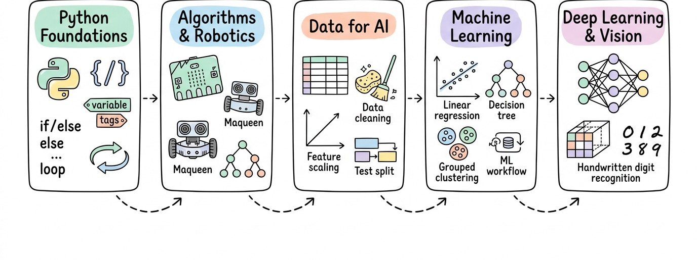

::: {.course-banner-container}
{.course-banner-img fig-alt="Introduction to AI with Python Sketchnote Roadmap"}
:::

# Introduction to AI with Python

Welcome to the **Introduction to AI with Python** curriculum. This course guides learners from foundational Python programming and algorithmic thinking through educational robotics with the BBC micro:bit and Maqueen robot, to applied data preparation, classical machine learning with scikit-learn, and introductory deep learning for computer vision.

🗺️ **Interactive Roadmap**: Explore our interactive [Mindmap of the Course](mindmap.html) for a zoomable, bird's-eye view of all curriculum topics and direct section links.

## 🧭 Course Navigation {#course-navigation}

::: {.course-banner-container}
{.course-banner-img fig-alt="Introduction to AI with Python Curriculum Roadmap"}
:::

The course is organised into self-contained modular session directories located directly under the repository root. Each session houses its own local assets, companion practice notebooks, and required datasets.

::: {.info-stack}
::: {.info-card}
#### 🐍 [Session 02: Python Foundations and Algebra](<02-Python-Foundations-and-Algebra/Session2 Python Foundations and Algebra.ipynb>)
[Foundations & Number Systems]{.focus-badge}

Variables & Data Types · Memory Inspection · Variable Naming Conventions · Binary, Decimal & Hexadecimal Systems · Arithmetic Operators & Precedence
:::

::: {.info-card}
#### 🔀 [Session 03: Selection and Boolean Logic](<03-Selection-and-Boolean-Logic/Session3 Selection and Boolean Logic.ipynb>)
[Conditional Logic & Decision Making]{.focus-badge}

Boolean Values · Comparison Operators · if / elif / else Branches · Logical and / or / not · Bitwise Operators & Truth Tables
:::

::: {.info-card}
#### 🔁 [Session 04: Iteration, Program Libraries and Functions](<04-Iteration-Libraries-and-Functions/Session4 Iteration, Program Libraries and Functions.ipynb>)
[Loops & Function Architecture]{.focus-badge}

while & for Loop Patterns · Accumulators & Counters · range() Control · Python Standard Library Modules · Reusable Function Definition & Return Values
:::

::: {.info-card}
#### ⚙️ [Sessions 05–06: Function Design and Algorithm Design](<05-06-Function-and-Algorithm-Design/Session5-6 Function Design and Algorithm Design.ipynb>)
[Modular Code & Algorithm Thinking]{.focus-badge}

Default Arguments & Keyword Parameters · Docstrings & Type Annotations · Searching & Sorting Principles · Python Built-in Sorts · Micro:bit Logic Walkthroughs
:::

::: {.info-card}
#### 📦 [Sessions 07–08: Strings and Data Structures](<07-08-Strings-and-Data-Structures/Session7-8 Strings and Data Structures.ipynb>)
[Text Processing & Data Collections]{.focus-badge}

String Methods & f-string Formatting · Lists, Tuples, Sets & Dictionaries · Collection Conversions · Performance Characteristics · Micro:bit Interactive Badge & Quiz
:::

::: {.info-card}
#### 🤖 [Session 09: Programming for Maqueen Robot](<09-Programming-for-Maqueen-Robot/Session9 Programming for Maqueen Robot.ipynb>)
[MicroPython & Mobile Robotics]{.focus-badge}

Maqueen Car Architecture · Indicator & NeoPixel RGB LEDs · Dual DC Motor Control & Steering · Ultrasonic Distance Sensing · Infrared Line Following Routines
:::

::: {.info-card}
#### 🧠 [Session 11: Introduction to AI](<11-Introduction-to-AI/Session11 Introduction to AI.ipynb>)
[AI Landscape & Historical Schools]{.focus-badge}

AI vs ML vs DL Relationships · Symbolic AI & Expert Systems · Supervised vs Unsupervised Learning · Regression, Classification & Clustering · Loading Tabular Data
:::

::: {.info-card}
#### 📊 [Session 12: Data for Machine Learning](<12-Data-for-Machine-Learning/Session12 Data for Machine Learning.ipynb>)
[Data Wrangling with Pandas]{.focus-badge}

Structured vs Unstructured Data · Parameters vs Hyperparameters · Missing Value Imputation · Filtering & Grouping · Merge & Join Operations · Matplotlib Visualisations
:::

::: {.info-card}
#### 🔬 [Sessions 13–14: Machine Learning Essentials](<13-14-Machine-Learning-Essentials/Session13-14 Machine Learning Essentials.ipynb>)
[Classical ML Workflows]{.focus-badge}

Linear Regression · K-Nearest Neighbours · Decision Trees · Random Forests · Gradient Boosting · scikit-learn Pipelines · California Housing & Customer Clustering
:::

::: {.info-card}
#### 📐 [Session 15: Machine Learning Evaluation](<15-Machine-Learning-Evaluation/Session15 Machine Learning Evaluation.ipynb>)
[Model Validation & Performance Metrics]{.focus-badge}

Confusion Matrix · Precision, Recall & F1-score · Mean Squared Error & R² · Overfitting vs Underfitting Diagnostics · K-Fold Cross-Validation Strategies
:::

::: {.info-card}
#### 👁️ [Session 16: Introduction to Deep Learning and Image Processing](<16-Deep-Learning-and-Image-Processing/Session16 Introduction to Deep Learning and Image Processing.ipynb>)
[Neural Networks & Computer Vision]{.focus-badge}

Deep Learning Architectures · Convolutions, Kernels & Feature Maps · Pooling & Non-linearities · AlexNet, VGG & ResNet Evolution · MNIST Digit Classification
:::
:::

## 🎯 Core Competencies {#core-competencies}

::: {.info-stack}
::: {.info-card}
#### 🐍 Python Programming & Data Structures
Master programming essentials from primitive types and control flow to advanced collection data structures (lists, tuples, sets, dictionaries) and custom function design.
:::

::: {.info-card}
#### 🤖 Applied Robotics & Hardware Control
Bridge software and physical computing by authoring MicroPython scripts for the BBC micro:bit and Maqueen robotic platform to control motors, RGB lighting, and sensors.
:::

::: {.info-card}
#### 📊 Data Preparation & Analytics
Inspect, cleanse, filter, and transform real-world datasets with Pandas, handling missing data and performing multi-source joins and exploratory visualisations.
:::

::: {.info-card}
#### ⚙️ Machine Learning Pipeline Development
Implement standard machine learning workflows with scikit-learn, training linear regressors, decision tree ensembles, K-means clusters, and evaluating models with cross-validation.
:::

::: {.info-card}
#### 👁️ Deep Learning Foundations
Understand artificial neural units, forward propagation, convolutional image feature extraction, and convolutional neural network architectures for visual recognition.
:::
:::

## 🏗️ Practical Projects {#practical-projects}

::: {.info-stack}
::: {.info-card}
#### 🏎️ Autonomous Maqueen Obstacle Avoidance Robot
Program a two-wheeled robot car in MicroPython using ultrasonic distance sensors and a state-machine loop to detect barriers and navigate around obstacles.
:::

::: {.info-card}
#### 📈 California Housing Valuation Predictor
Develop a complete scikit-learn regression pipeline with data preprocessing, feature standardisation, and cross-validated error metrics to predict housing values.
:::

::: {.info-card}
#### 🛍️ Retail Customer Segmentation Engine
Apply K-means clustering to customer transaction data to discover distinct purchasing personas and build actionable marketing recommendation strategies.
:::

::: {.info-card}
#### 🔢 MNIST Handwritten Digit Classifier
Train and evaluate multilayer perceptron and convolutional neural network models to recognize handwritten digits with high accuracy and visual feature inspection.
:::
:::

## 💼 Career Impact {#career-impact}

::: {.info-stack}
::: {.info-card}
#### 💼 Technical Roles
Junior Python Developer · Data Analyst Trainee · Robotics Programming Instructor · Applied AI Assistant · STEM Technology Educator
:::

::: {.info-card}
#### 🏢 Industry Sectors
Technology & Software Services · Education & STEM Outreach · Industrial Automation · E-Commerce & Retail Analytics · Public Sector
:::

::: {.info-card}
#### 📁 Portfolio Projects
Maqueen robotics autonomous patrol algorithms · scikit-learn predictive pipelines · Customer segmentation models · MNIST image classifier notebooks
:::
:::

## 🚀 Getting Started {#getting-started}

::: {.info-stack}
::: {.info-card}
#### 🌐 In Your Browser
Read curriculum materials, examine interactive diagrams, and review code examples directly on this website without local software installation.
:::

::: {.info-card}
#### ☁️ Google Colab
Launch hands-on exercises in the cloud with the **Open in Colab** badge in each lecture. Sample datasets download automatically in the notebook.
:::

::: {.info-card}
#### 💻 Local Development
Clone this repository and set up a Python 3.10+ virtual environment (`.venv`) with `pandas`, `numpy`, `matplotlib`, `scikit-learn`, and `torch` to run all notebooks locally.
:::
:::

## 🎓 Other Curricula {#other-curricula}

::: {.info-stack}
::: {.info-card}
#### 🤖 [Artificial Intelligence Skill Set](https://wlos.github.io/AI_SS/) · [GitHub Repository](https://github.com/wlos/AI_SS)
An advanced curriculum exploring PyTorch deep learning, convolutional neural network architectures, transfer learning, and Hugging Face Transformers.
:::

::: {.info-card}
#### 🔌 [Build AI Apps with REST API & MCP](https://wlos.github.io/Connect-AI-using-REST-API/) · [GitHub Repository](https://github.com/wlos/Connect-AI-using-REST-API)
Connect AI assistants to enterprise business systems through robust RESTful APIs, FastAPI microservices, and the open Model Context Protocol (MCP).
:::

::: {.info-card}
#### 📊 [Data Analysis with Python](https://wlos.github.io/DA_with_Python/) · [GitHub Repository](https://github.com/wlos/DA_with_Python)
Comprehensive data analysis pipeline covering Pandas data wrangling, Matplotlib / Seaborn visualisation, hypothesis testing, and scikit-learn statistical modelling.
:::
:::
